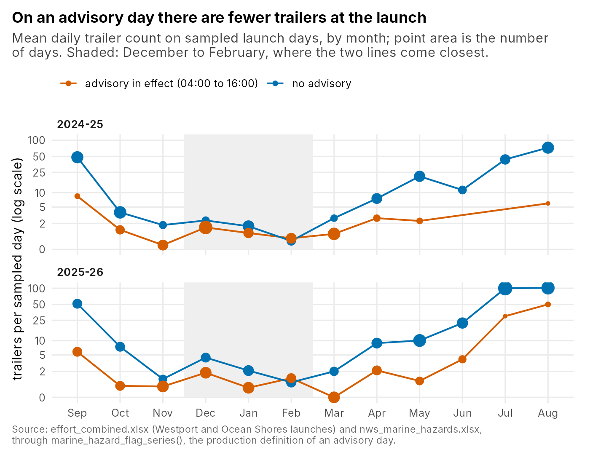
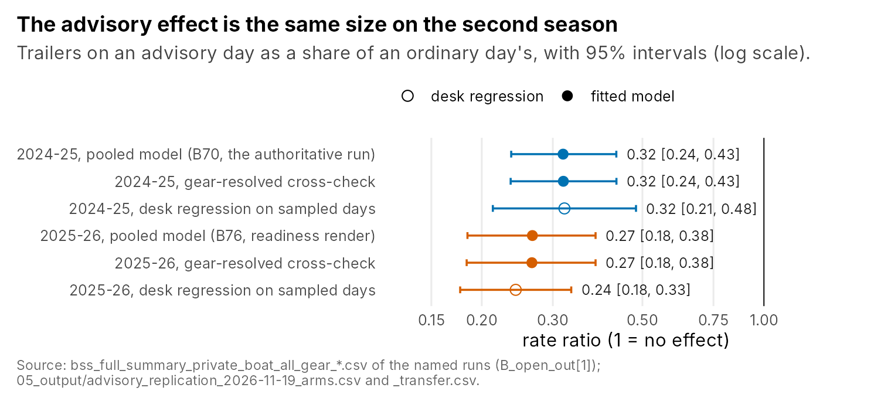
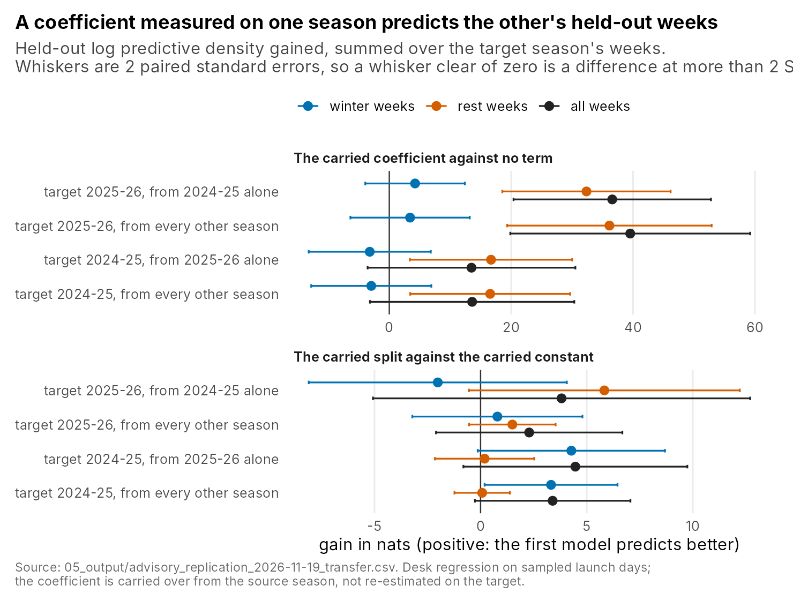
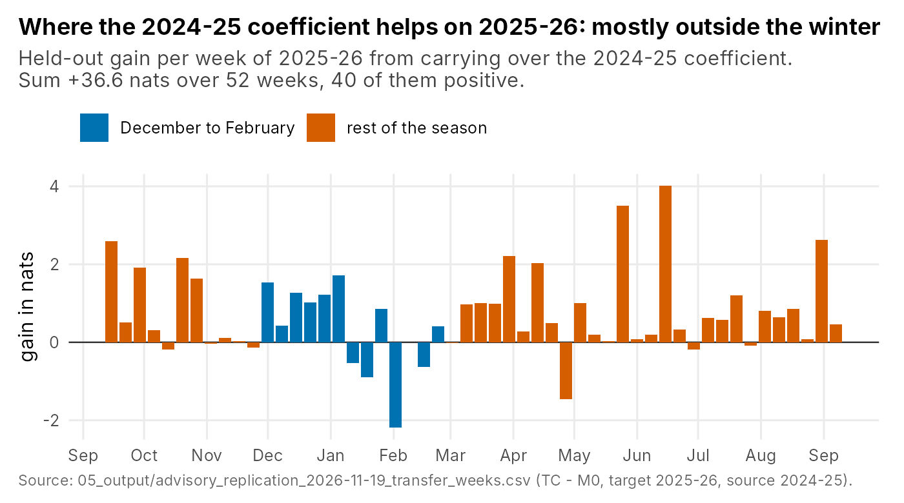
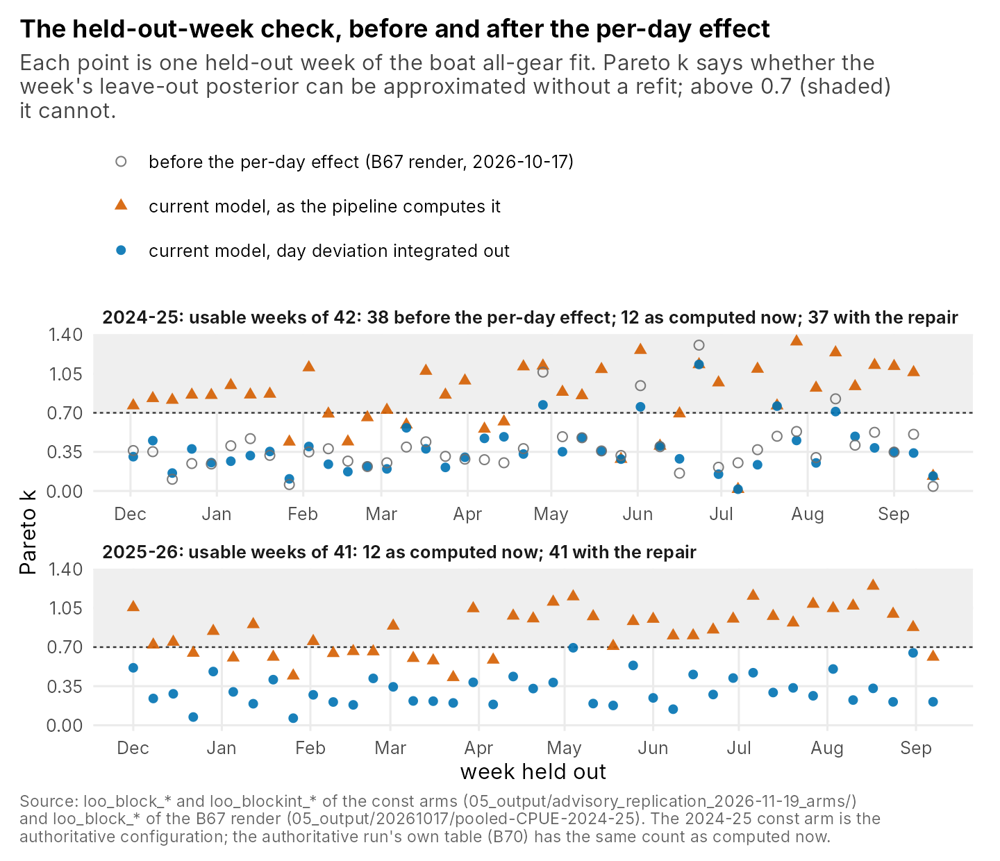
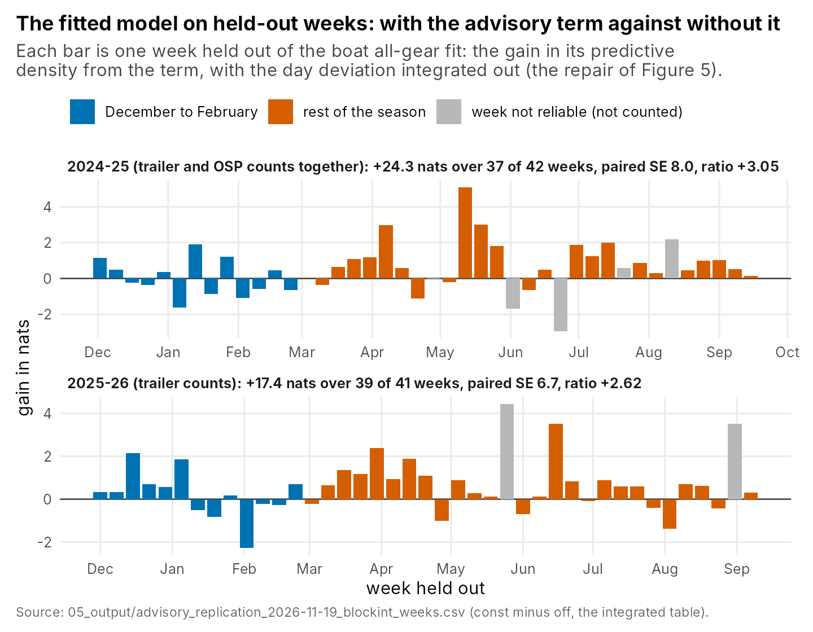
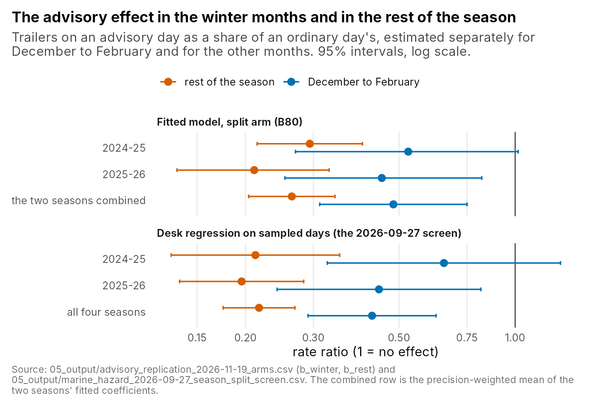
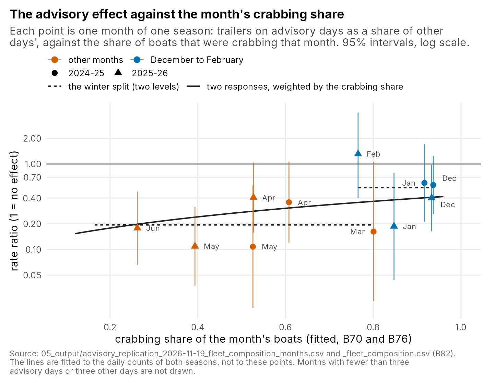
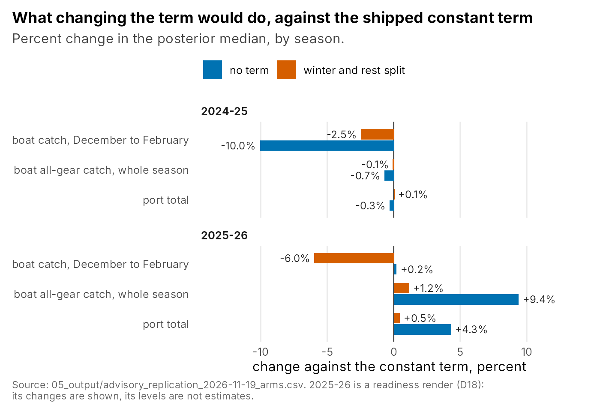
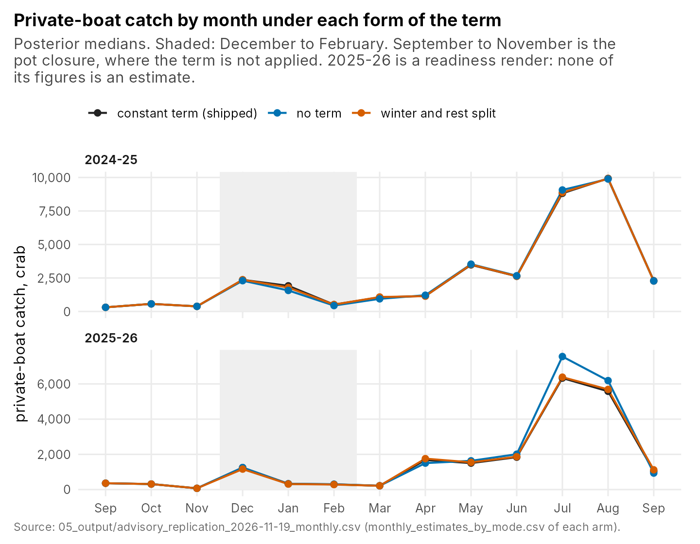

# The boat advisory term on a second season: decision brief (A30, D31, D32)

- **Date:** 2026-11-19. **For:** Matt George.
- **Status:** nothing in the method changed. The shipped term is the one adopted on 2026-09-27. The decisions asked of you are in Section 8.
- **Authoritative run:** B70, unchanged: port 86,497 [72,869, 104,595].
- **Record:** CHANGE_REGISTER A30, B80 to B83, D30, D31, D32, D54 and D55; VALIDATION_CAMPAIGN Section 1z.21.
- **Evidence:** the tables `05_output/advisory_replication_2026-11-19_*.csv`, and the files kept for each model arm under `05_output/advisory_replication_2026-11-19_arms/`.
- **Scripts**, all in `06_diagnostics/` and dated `2026-11-19`: `desk_advisory_transfer`, `run_advisory_replication`, `desk_advisory_block_cv`, `run_block_cv_exact_refit`, `desk_advisory_crab_share`, `desk_advisory_fleet_composition` and `desk_advisory_brief_figures`.
- **Reading rules:** each was committed before the measurement it judges: `af9e2b7` (R1 to R8), `e4f88f8` (R3a), `da77171` (R9), `7ed1b27` (R10), `8f9601d` (R11).
- **This file** is built from `A30-advisory-term-brief-2026-11-19.md` with pandoc. Edit the markdown, not the Word file.

## 1. Summary

The Small Craft Advisory term on private-boat effort was adopted on 2026-09-27 on the evidence of one season. Two questions were left open: whether it holds on a season it was not chosen on (D31), and whether one coefficient is right for the winter (D32). 2025-26 now has a full season of trailer counts, so both were asked of it, with each reading rule committed before its measurement.

**The term holds on a second season.**

- Carried to 2025-26 without re-estimation, the coefficient fitted on 2024-25 improves the prediction of that season's held-out weeks by 36.6 nats, 4.5 standard errors.
- In the production model, 2025-26 weeks held out of the fit are predicted better with the term than without it: +17.4 nats, 2.6 standard errors, on the trailer counts alone. On 2024-25 the same test gives +24.3 nats at 3.0 standard errors, which is the adoption evidence reproduced on the current model.
- Without the term, the model credits advisory days with nearly three times the trailers that were counted on them, on both seasons.

**The winter effect is weaker, and modelling that changes almost nothing.** The two seasons together establish it: on a winter advisory day the launch has about half the trailers of an ordinary winter day, against about a quarter in the rest of the season, 2.5 standard errors apart. A model with a separate winter coefficient predicts held-out weeks no better (0.2 standard errors on either season) and moves the authoritative port total from 86,497 to 86,555, which is 0.1%.

**There is a credible reason for the winter difference.** Crabbing boats are put off less than the rest of the fleet: OSP's crab-only boats are 29% of its sampled boats on advisory days against 12% on other days, and in the winter nine boats in ten at the launch are crabbing. From March to September the model's existing volume term already carries this. A plain winter boundary describes the counts at least as well as the fleet does, so the reason is credible, not proven.

**The term is worth little to the authoritative total, and a lot to a season that OSP does not yet hold.** On 2024-25, where the OSP counts hold the boat level from March on, removing the term lowers the port total by 0.3%. On 2025-26, which has no OSP count after the pot opening yet, removing it raises the boat figure by 9.4%.

**Something was broken, and I got something wrong.** The pipeline's held-out-week check, the instrument the term was adopted on, has returned mostly unusable weeks since the per-day effort effect was adopted on 2026-10-18: 12 of 42 on the authoritative run, against 38 before. Nobody had looked, including me when I named that check in this test's rule. A repaired check was specified before any comparison existed, and it agrees with an exact refit of two held-out weeks to 0.02 nats. It is the instrument behind the second bullet above (D54).

**What I recommend.** Keep the one-coefficient term and write down the conditions for reopening the winter question; close D31; build the repaired check into the pipeline. Adopting the winter split is a defensible second choice and Section 7 says why I put it second. The options, each with its positives and negatives, are in Section 6, and the five decisions asked of you are in Section 8.

| | 2024-25 (authoritative) | 2025-26 (readiness render) |
|--------------------------------|------------------------|------------------------|
| Advisory coefficient, shipped term | -1.15 [-1.44, -0.84] | -1.32 [-1.69, -0.96] |
| Trailers on an advisory day, as a share of an ordinary day's | 0.32 | 0.27 |
| Held-out weeks, with the term against without | +24.3 nats, 3.0 SE | +17.4 nats, 2.6 SE |
| Winter and rest coefficients, split arm | -0.64 and -1.23 | -0.80 and -1.56 |
| Held-out weeks, split against one coefficient | +0.3 nats, 0.2 SE | +0.6 nats, 0.2 SE |
| Boat all-gear catch without the term | -0.7% | +9.4% |
| Boat all-gear catch under the split | -0.1% | +1.2% |
| Port total under the split | +0.1% | +0.5% |

No 2025-26 figure in this brief is an estimate of that season's harvest (D18).

## 2. Background

### 2.1 What the term is

The private-boat effort process is a latent daily level: in log terms a season mean plus an autoregressive deviation, a weekend effect with a Sunday increment, and a holiday effect. Since 2026-09-27 it carries one more term on the all-gear fit (`02_stan_models/crab_bss_pooled.stan:793` to `796`):

```
log lambda[d] = mu + AR[period(d)] + B1 * weekend[d] + B1_sun * sunday[d]
                + B2 * holiday[d] + B_open * advisory[d]
```

`advisory[d]` is 1 on a day when the National Weather Service had a Small Craft Advisory or a stronger marine hazard in effect at any moment between 04:00 and 16:00 local time, for the Grays Harbor Bar (zone PZZ110) or the coastal waters off Westport (PZZ156). It is read from the archived NWS event record in `04_input_files/nws_marine_hazards.xlsx`, so it is known for every day of the season, sampled or not. `B_open` is one coefficient for the whole season, with a normal(0, 1) prior.

On the authoritative run the fitted coefficient is -1.15 [-1.44, -0.84], a rate ratio of 0.32: on an advisory day about a third as many trailers are at the launch as on an ordinary day.

### 2.2 Why a day covariate matters to the estimate

The boat effort is counted on some days and interpolated on the rest. On 2024-25 the launches were counted on 143 of the 289 days of the all-gear window. On the other 146 the advisory flag is the only information the model has that a day was not an ordinary one.

Since the per-day effort effect was adopted (A39, 2026-10-18) the flag matters on the sampled days as well. The model now explains a sampled day's departure from the season's level with a deviation that belongs to that day alone. For the boat, that deviation is treated as noise in the count: a boat day's reported effort is built from the level, not from the count (`crab_bss_pooled.stan:1195` to `1199`, with `eday_of_day` built from the shore gear counts only at lines 535 to 537; for the shore the deviation is carried into the day's effort). So a day that is known to be bad lowers the boat estimate only if a covariate says so. Section 4.7 measures what that is worth.

The term's effect on the total therefore has two parts with opposite signs:

- **The level rises.** Sampled days were advisory days more often than unsampled days (41% against 30% on 2024-25; 38% against 33% on 2025-26). Without the term the low counts of the sampled advisory days pull the level down, and the mostly calm unsampled days inherit it.
- **The advisory days fall.** With the term, each advisory day, sampled or not, is credited with about a third of the level instead of all of it.

At adoption the first outweighed the second, and the term raised the 2024-25 boat all-gear estimate by 3.8%. Which of the two wins depends on the season and on what else holds the level (Section 4.7).

### 2.3 How it was adopted, and what the evidence was

The term was adopted on 2026-09-27 (CHANGE_REGISTER A30), on one season:

- it was **identified** on 2024-25 at eight standard errors (coefficient -1.16 [-1.45, -0.87] at the time);
- on **held-out weeks of 2024-25** (one week left out at a time, D31) it improved the prediction by 26.8 nats at 2.9 paired standard errors over the two boat effort streams together. The OSP counts carried that result (+18.9 at 3.9 SE); the trailer counts alone gave +7.9 at 1.2 SE;
- a shore term was not identified, and the samplers' bar-restriction tick added nothing beyond the archive, so neither was adopted.

A nat is the unit of the log predictive density: a model that gains one nat makes the held-out counts 2.7 times more probable. A paired standard error is the standard error of the sum of the week-by-week differences between two models scored on the same weeks.

### 2.4 What was left open

Two things, and they are the subject of this brief.

1. **D31, on another season.** Held-out weeks of the season a term was chosen on are a weaker test than a season it was not chosen on. That test had never been run.
2. **D32, the winter.** At adoption the term moved the boat estimate most in December to March, and that is where no held-out test on 2024-25 could see: the OSP counts start in March. The four-season desk screen of 2026-09-27 put the winter effect at a rate ratio of 0.43 against 0.22 for the rest of the season. Fitted to 2024-25 alone, a separate winter coefficient could not be placed (-0.59 [-1.24, +0.06], rung M6). The shipped model fits one coefficient for the season, so its winter correction rests on December behaving like June.

A third open item is a neighbour of both. **D30**: the term is fitted to counts of all private boats, and the estimate needs crabbing boats. If crabbing boats respond to an advisory differently from the rest of the fleet, a coefficient fitted to all boats is not theirs.

### 2.5 What "out of sample" can and cannot mean here

It would be wrong to call 2025-26 a blind test. The 2026-09-27 desk screen read that season's trailer days before the term was adopted, so the association was known to be there. Two things are nonetheless out of sample, and they are what was tested:

- **the coefficient's value.** The 2024-25 fit never saw a 2025-26 count. Carrying its coefficient to 2025-26 without re-estimating it, and asking whether it predicts counts held out of the target's own fit, is a test the coefficient could fail;
- **held-out weeks within 2025-26**, scored with and without the term in the fitted model.

2025-26 itself is a readiness season: its boat all-gear fit has no OSP day yet (D18) and its turnover is its prior (A41). The advisory term sits on the presence process, which the trailer counts observe, so neither fact touches the test. **No 2025-26 figure in this brief is an estimate.** Where a 2025-26 quantity is quoted it is to show what a change does, not what the harvest was.

## 3. What was done

**The rule first.** Each reading rule and the outcome expected were written into the register and the script's header, and committed, before the measurement they judge was run (the practice Nosek et al. 2018 describe as preregistration):

| Rule | What it judges | Committed | Before |
|-------|------------------------------|--------------|------------------------------------|
| R1 to R8 | the transfer test and the six model arms | `af9e2b7` | any measurement on either season |
| R3a | the repaired held-out-week check (Section 4.4) | `e4f88f8`, 04:33 UTC | the second arm finished at 04:41, so before any pair of arms existed |
| R9 | the crab-only share on advisory days (Section 4.6) | `da77171` | the regression; only the table's header and three rows had been read |
| R10 | the effect against the crabbing share (Section 4.6) | `7ed1b27` | any of its models was fitted to the data; one dry run on a permuted flag |
| R11 | an exact refit, to accept or reject the repaired check (Section 4.4) | `8f9601d` | any refit was sampled; one dry run, which printed the two weeks the rule selects |

R9 and R10 are labelled exploratory in their own text: they were added during the work, after the first results suggested a reason for the winter difference, and they judge nothing in R1 to R8.

**Three instruments.**

1. **The transfer test** (desk; seconds). For a target season, leave one ISO week out, fit calendar month, weekend and the negative-binomial dispersion on the target's other weeks, and score the held-out week under four models: no advisory term; the source season's constant coefficient carried over as an offset, not re-estimated; the source's winter and rest coefficients carried over; and a coefficient estimated on the target's own training weeks, as the ceiling. Scores are the held-out days' log predictive densities under the fitted regression, summed over weeks, with a paired standard error over weeks (the leave-one-out comparison of Vehtari et al. 2017 and Gelman et al. 2013, Chapter 7, with weeks as the blocks, as Roberts et al. 2017 recommend for data with temporal structure). Its mechanics were dry-run on 2023-24, a season the rule does not judge.
2. **Six renders of the production model** (pooled driver, `run_config.R` as shipped, one change on the marine hazard keys). Three arms per season: `const`, the shipped term; `off`, no term; `split`, a winter coefficient (December to February) and a rest-of-season coefficient. On 2025-26 and on 2024-25.
3. **The held-out-week check of the fitted model**, repaired (Section 4.4), applied to each arm, and tested against an exact refit of two held-out weeks.

**Two desk checks on the mechanism** (R9, R10): OSP's crab-only boats on advisory days, and the advisory effect on the trailer counts against each month's crabbing share.

**The platform.** The renders ran on this session's container: R 4.6.2, rstan 2.32.7 and StanHeaders 2.32.10, the lock file's Stan versions built from source. Comparisons are between arms on that one platform. The first arm of each season is the shipped configuration, and each reproduced its committed render byte for byte in the saved draws of every fit and in the component totals: the readiness render B76 on 2025-26, and the authoritative run B70 on 2024-25, port total 86,497. So the comparisons below start from the authoritative fit itself, not from a near copy of it. CRAN's current Stan no longer parses the model code; that is a separate finding, recorded as D53.

## 4. The evidence

### 4.1 The raw contrast



*Figure 1. Mean trailers per sampled launch day, on advisory days and on other days, by month.*

No model is needed to see the effect. In both seasons, and in nearly every month, advisory days have a fraction of the trailers of other days. The winter months are the exception that D32 is about: there the two lines come close, and in February of both seasons they cross. Winter counts are also very small, a handful of trailers a day at most, which is why the winter is hard to measure by any method.

### 4.2 The coefficient on the two seasons



*Figure 2. The advisory effect as a rate ratio, by season, model and method.*

| Fit | Coefficient | Rate ratio |
|----------------------------------------|--------------------------------|------------------|
| 2024-25, pooled model (authoritative run B70) | -1.146 (SD 0.155) [-1.442, -0.842] | 0.32 [0.24, 0.43] |
| 2025-26, pooled model (readiness render B76) | -1.321 (SD 0.186) [-1.691, -0.960] | 0.27 [0.18, 0.38] |
| 2024-25, gear-resolved model | -1.144 (SD 0.154) | 0.32 |
| 2025-26, gear-resolved model | -1.323 (SD 0.188) | 0.27 |
| 2024-25, desk regression on sampled days | -1.138 (SE 0.208) | 0.32 [0.21, 0.48] |
| 2025-26, desk regression on sampled days | -1.416 (SE 0.162) | 0.24 [0.18, 0.33] |

The two seasons' fitted coefficients are 0.72 standard errors apart. These were read before the rule was written, so the rule does not judge their agreement. They are the reason the question was worth asking, not the answer to it.

### 4.3 The transfer test: does one season's coefficient predict the other's held-out weeks?



*Figure 3. The transfer test. Top: the carried coefficient against no term. Bottom: the carried split against the carried constant.*

| Target | Source of the coefficient | Carried coefficient against no term | Carried split against carried constant | Target's own coefficient against the carried one |
|---------|--------------|------------------------|------------------|------------------|
| **2025-26** | **2024-25 alone** | **+36.6 nats (SE 8.1), 4.5 SE; 40 of 52 weeks positive** | +3.8 (SE 4.4), 0.9 SE | +1.4 (SE 2.6), 0.5 SE |
| 2025-26 | every other season | +39.5 (SE 9.8), 4.0 SE | +2.3 (SE 2.2), 1.0 SE | -1.6 (SE 0.8), -2.0 SE |
| 2024-25 | 2025-26 alone | +13.5 (SE 8.5), 1.6 SE; 31 of 48 weeks positive | +4.5 (SE 2.6), 1.7 SE | -1.4 (SE 2.0), -0.7 SE |
| 2024-25 | every other season | +13.6 (SE 8.4), 1.6 SE | +3.4 (SE 1.8), 1.9 SE | -1.6 (SE 1.8), -0.9 SE |

The first row is the pre-registered test. **The coefficient measured on 2024-25, carried to 2025-26 without re-estimation, improves the prediction of that season's held-out weeks by 36.6 nats, at 4.5 paired standard errors.** A coefficient estimated on 2025-26's own weeks does no better than the carried one (+1.4 at 0.5 SE), so the two seasons' effects are not distinguishable in prediction either.

The mirror, the 2025-26 coefficient carried back to 2024-25, is positive at 1.6 SE: the same direction, short of the 2 SE the rule asks for. The reason is visible when the weeks are split.



*Figure 4. Where the carried coefficient helps on 2025-26, week by week.*

| Target, source | Rest-of-season weeks | Winter weeks (December to February) |
|--------------------|------------------------------|------------------------------|
| 2025-26, from 2024-25 | +32.4 (SE 6.9), 4.7 SE, 39 weeks | +4.2 (SE 4.1), 1.0 SE, 13 weeks |
| 2024-25, from 2025-26 | +16.7 (SE 6.7), 2.5 SE, 35 weeks | -3.2 (SE 5.0), -0.6 SE, 13 weeks |

Outside the winter a carried constant coefficient predicts the other season at 4.7 and 2.5 SE. In the winter weeks it adds nothing that can be measured, and on 2024-25 its sign is negative. That is D32 seen out of sample: a coefficient sized on the whole season is too strong for the winter of 2024-25.

**On the shape.** The carried split beats the carried constant in all four rows, by 0.9 to 1.9 SE. Each is short of 2 SE, so at this level the shape cannot be told apart out of sample; the direction is the same every time.

**What this test is not.** It is a regression on daily counts, not the state-space model: no autoregressive process, no turnover, no catch. It says the association carries between seasons with a stable size. Whether the term improves the production model's own predictions is the next section.

### 4.4 The fitted model on held-out weeks

**The check the rule named had stopped working.** Rule R3 named the pipeline's held-out-week check (B39, 2026-09-26), the instrument D31 was measured with. On the first arm it returned 12 usable weeks of 41. The cause was not this batch. The committed tables of the authoritative run show the same thing, 12 usable weeks of 42, against 38 of 42 on the render before the per-day effort effect was adopted. Nobody had opened those tables since, including me when I wrote the rule: its stated expectation for R3 on 2024-25 was a pass, taken from the September result. That is recorded as a defect of the rule.



*Figure 5. The reliability of the held-out-week check, week by week: before the per-day effect, as the pipeline computes it now, and with the repair.*

**Why it fails.** The check approximates the fit without a week by reweighting the posterior draws with that week's likelihood, so no refit is needed. The reweighting is trustworthy only when removing the week changes the posterior modestly; the Pareto k statistic measures that, and above 0.7 the approximation is not to be used (Vehtari et al. 2024). Since A39 each sampled day has its own deviation, and a held-out week's counts are exactly what pin those days' deviations. With the week removed the deviations revert to their prior. The reweighting would have to stretch a narrow distribution into a wide one, and it cannot.

**The repair.** Average the day's deviation out of both the weights and the score. That asks the question an unsampled day actually poses: what do the counts look like when the day's deviation is not known? This is integrated importance sampling, the established treatment of a latent variable tied to the held-out unit (Li et al. 2016; see also Merkle, Furr and Rabe-Hesketh 2019 and Vehtari et al. 2016). For a sampled day with trailer counts y1 to ym the day's likelihood becomes

```
p(y | theta) = integral of  prod_j NB(y_j | lambda / R * exp(sigma z - sigma^2 / 2), r)
               N(z | 0, 1) dz
```

computed by quadrature. The OSP likelihood carries no day deviation in the model and enters unchanged. Figure 5 shows the effect: with the repair the check behaves as it did before the per-day effect. On the authoritative configuration 37 of 42 weeks are usable, and four of the five that are not are the four that were not usable before.

**How the rule was kept honest.** R3 was left as written; it reads "not evaluable" on both seasons. An addendum, R3a, sets the same comparison, the same evaluability bar and the same thresholds on the repaired check. It was committed at 04:33 UTC, after the first arm alone had been read and while the second arm, the first that any comparison needs, was still sampling; that arm finished at 04:41. Two preconditions were set with it and both are met on every arm: the script reproduces the fit's own likelihood from its draws (to 4e-13), and doubling the integration grid moves no week (to 2e-14 nats).

**The acceptance test (R11).** The repaired check is still an approximation to refitting the model without a week, and the direct test of that is to refit. Two weeks of the 2025-26 shipped arm were chosen by a rule committed first, each was removed from the fit's own data, the boat all-gear fit was sampled again without it, and the removed week was scored exactly.

| Week held out | Why this week | Pareto k | Exact refit | Repaired check | Gap |
|----------------------|--------------------------------|------|--------|--------|----------|
| 2026-W19 (7 counts on 5 days) | the hardest for the approximation: the largest k | 0.69 | -25.975 | -25.997 | -0.022 nats |
| 2025-W51 (12 counts on 4 days) | a typical one: the median k | 0.28 | -6.539 | -6.519 | +0.020 nats |

The tolerance set in advance was 0.25 nats, the size at which errors would begin to matter to a sum over 40 weeks. Both weeks are within 0.03 nats, one to two Monte Carlo standard errors of the exact value. On this fit the repaired check can be read as if it were a refit.

**The result.** With the repaired check the comparison the rule asked for can be read on both seasons.



*Figure 6. The fitted model on held-out weeks, with the term against without it, week by week (the repaired check).*

| Season | Check | With the term against without | Weeks usable | Reading |
|---------|------------------------------|--------------------------------|---------|---------------|
| 2024-25 | as the rule named it (R3), trailer and OSP counts together | +4.3 nats (SE 3.8), 1.1 SE; 5 weeks positive | 9 of 42 | not evaluable |
| **2024-25** | **repaired (R3a), trailer and OSP counts together** | **+24.3 nats (SE 8.0), 3.0 SE; 26 weeks positive** | **37 of 42** | **PASS** |
| 2025-26 | as the rule named it (R3), trailer counts | +1.7 nats (SE 2.0), 0.8 SE; 4 weeks positive | 7 of 41 | not evaluable |
| **2025-26** | **repaired (R3a), trailer counts** | **+17.4 nats (SE 6.7), 2.6 SE; 27 weeks positive** | **39 of 41** | **PASS** |

**On 2025-26, the season the term was not chosen on, it improves the production model's prediction of held-out weeks at 2.6 standard errors, on the trailer counts alone.** I had expected that row to fall short of 2 SE, because at adoption the trailer counts alone gave 1.2 SE on 2024-25 and the OSP counts carried the result.

On 2024-25 the repaired check gives +24.3 nats at 3.0 SE over the two streams together: +18.1 at 3.9 SE on the OSP counts and +6.4 at 1.2 SE on the trailer counts. Those are almost exactly the figures the term was adopted on in September (+18.9 at 3.9 SE and +7.9 at 1.2 SE, on the model as it then was). 2024-25 is the adoption season, so this is not new evidence for D31. What it shows is that the adoption evidence survives the model changes made since, and that the repaired check recovers what the original check said before it broke.

By week set the two seasons repeat the transfer test's pattern:

| Season | Rest-of-season weeks | Winter weeks (December to February) |
|---------|------------------------------------|------------------------------------|
| 2024-25 | +24.1 (SE 6.5), 3.7 SE, 24 usable weeks | +0.2 (SE 3.7), 0.1 SE, 13 weeks |
| 2025-26 | +14.7 (SE 5.3), 2.8 SE, 26 usable weeks | +2.8 (SE 4.1), 0.7 SE, 13 weeks |

The standard errors above treat weeks as independent. Allowing for autocorrelation between weeks (a Newey-West standard error with four lags) the two results read 2.8 and 2.2 SE, and 26 of 37 and 27 of 39 weeks are positive (sign test p 0.010 and 0.012).

**What no test here can see is the winter.** In four separate readings, two seasons by two instruments, the winter weeks contribute between -3.2 and +4.2 nats with standard errors of about 4. Winter days have too few trailers for a held-out week to register a coefficient, right or wrong.

### 4.5 The winter question



*Figure 7. The advisory effect in December to February and in the rest of the season, by season and method.*

| Fit | Winter coefficient | Rest of season | Winter minus rest | Rule R4 |
|------------------|------------------|------------------|----------------|--------------------|
| 2024-25, split arm | -0.64 [-1.31, +0.02], rate ratio 0.53 | -1.23 [-1.54, -0.91], rate ratio 0.29 | +0.59 (SD 0.37), 1.6 SD | (a): the winter coefficient cannot be placed on this season alone |
| 2025-26, split arm | -0.80 [-1.37, -0.20], rate ratio 0.45 | -1.56 [-2.02, -1.11], rate ratio 0.21 | +0.76 (SD 0.38), 2.0 SD | (b): both identified, and they differ |
| **The two seasons' split arms combined (R5)** | **-0.73 (SE 0.22), rate ratio 0.48** | **-1.33 (SE 0.13), rate ratio 0.26** | **+0.67 (SE 0.27), 2.5 SE** | **established: the winter effect is the smaller reduction** |
| Desk regression, the two seasons pooled (B82) | rate ratio 0.53 | 0.19 [0.14, 0.28] | +1.01 [0.43, 1.58], 3.4 SE | not a rule quantity |
| Desk screen, four seasons (2026-09-27) | 0.43 [0.29, 0.62] | 0.22 [0.18, 0.27] | 3.0 SE (1.4 SE under a quasi-Poisson variance) | not a rule quantity |

Both outcomes are the ones written down in advance. On 2024-25 alone the winter coefficient's interval just reaches zero, as it did at adoption. On 2025-26 the two coefficients differ at 2.0 standard deviations. The two seasons agree with each other (their differences are 0.3 standard errors apart), and together they put the winter effect at about half the size of the rest of the season's on the log scale: on a winter advisory day about half the trailers of an ordinary winter day, against about a quarter in the rest of the season. **By the rule, the two seasons together establish that the winter effect is the weaker one.**

The pooled desk regression and the four-season screen say the same with more data and less model. The screen's result depends on the variance assumption (3.0 SE under a negative binomial, 1.4 SE under a quasi-Poisson), which is a reason to prefer the fitted model's reading: it is the one the estimate is built from.

**Does modelling the difference predict better?** Not measurably.

| Comparison | Split against constant | Reading |
|------------------------------------|------------------------------|--------------------|
| Out of sample: the 2024-25 split carried to 2025-26 (R6) | +3.8 nats (SE 4.4), 0.9 SE | cannot be told apart |
| The other three transfers | +2.3, +4.5 and +3.4 nats; 1.0, 1.7 and 1.9 SE | every one positive, none beyond 2 SE |
| Fitted model, 2024-25 held-out weeks (repaired check) | +0.3 nats (SE 1.7), 0.2 SE; 36 of 42 weeks | no difference |
| Fitted model, 2025-26 held-out weeks (repaired check) | +0.6 nats (SE 2.5), 0.2 SE; 41 of 41 weeks | no difference |
| Desk regression, held-out weeks of both seasons (B82) | +4.5 nats (SE 5.1), 0.9 SE | no difference |
| Catch fit, either season | +0.005 (SE 0.11) and +0.003 (SE 0.07) | unmoved |

So the winter effect is weaker, and a model that knows this predicts the counts no better than one that does not. The reason is arithmetic: winter days have a handful of trailers at most, so even a coefficient that is wrong by a factor of two there moves the predicted counts by a trailer or less.

Rule R4 has a second clause for a season in branch (b): the split "earns its place" on that season if it leaves the catch fit unmoved and is not worse on held-out weeks. On 2025-26 both hold, so by the rule the split earns its place on that season. That clause asks only that the split does no harm, and it does none. It is not a finding that the split helps.

### 4.6 Why the winter differs: a boundary, or the fleet?

A calendar boundary describes the difference; it does not explain it. An explanation was at hand, and two desk checks were run on it, each with its rule committed first (R9, R10). Both are exploratory and neither is the state-space model.

**The fleet at the launch changes through the season.** The fitted crabbing share of private boats is about 0.9 in the winter and falls to about a quarter by August:

| Season | Dec | Jan | Feb | Mar | Apr | May | Jun | Jul | Aug |
|------------------|-----|-----|-----|-----|-----|-----|-----|-----|-----|
| 2024-25 (B70) | 0.94 | 0.92 | 0.89 | 0.80 | 0.61 | 0.53 | 0.37 | 0.32 | 0.26 |
| 2025-26 (B76) | 0.93 | 0.85 | 0.77 | 0.50 | 0.53 | 0.39 | 0.26 | 0.17 | 0.16 |

In the winter the trailers are crabbers. In the summer most are other boats, many of which must cross the bar. If crabbing boats are put off less by an advisory than the rest of the fleet, the effect on all boats has to be weaker in the winter.

**R9: OSP's classified boats say crabbing boats are put off less (B81, for D30).** On the 115 OSP days of 2024-25 after the pot opening (March to September; 25 of them advisory days), crab-only boats were 29.1% of the boats OSP sampled on advisory days against 11.8% on other days.

| Model | Advisory coefficient | Odds ratio | Reading |
|------------------------------|------------------|------------------|------------------------------|
| Month and advisory | +1.04 [0.44, 1.64] | 2.82 [1.55, 5.15] | the crab-only share is higher on advisory days |
| Month, the day's boat volume, and advisory | +0.19 [-0.35, 0.73] | 1.21 [0.70, 2.08] | no difference beyond what the day's volume predicts |
| The same two with every boat taken as sampled (the other bound of D2) | +1.28 [0.43, 2.12] and +0.04 [-0.54, 0.62] | 3.58 and 1.04 | the same reading |

The second row is the rule's reading. Since A34 the model's crabbing share already rises on a low-volume day (its volume coefficient is -0.76 [-1.00, -0.52] on B70; this desk regression gives -0.85), and an advisory day is a low-volume day. So the model already carries this differential: on B70's coefficients an advisory day in a month with a crabbing share of 0.30 has 0.32 times the boats and a share of about 0.50, which is 0.54 times the crabbing boats. The OSP days do not ask for more than that, though the interval is wide enough to hide a further factor of two either way.

This narrows D30. It was "not measured"; it is now measured for March to September and found to be carried by the volume term. It says nothing about December to February, where OSP has no day.

**R10: the trailer counts on their own say the same thing (B82).** Four regressions on the 320 sampled launch days of the two seasons' all-gear windows (126 advisory days), each with a level per season-month and a weekend term:

| Form | What it says | AIC |
|------------------------|------------------------------------------------------|------|
| One coefficient | rate ratio 0.29 [0.22, 0.38] | 1845.5 |
| Winter split | rest 0.19 [0.14, 0.28]; winter 0.53; winter minus rest +1.01 [0.43, 1.58] on the log scale | 1836.0 |
| Log-linear in the month's crabbing share | the coefficient rises by 1.39 [0.37, 2.42] per unit of share: rate ratio 0.18 at a share of 0.25, 0.44 at 0.90 | 1840.1 |
| Two responses, weighted by the share | crabbing boats fall to 0.43 [0.29, 0.63] of an ordinary day's, other boats to 0.12 [0.04, 0.32] | 1841.4 |



*Figure 8. The advisory effect month by month against the month's crabbing share, with the two-response curve and the winter split's two levels.*

Three readings, by the rule:

1. **The effect weakens as the crabbing share rises** (+1.39, interval excluding 0, 2.7 standard errors).
2. **A boundary and the share cannot be told apart.** The winter split has the lower AIC by 4.1, and on held-out weeks the share-based form scores 4.5 nats below it at 0.9 SE. Figure 8 shows why the boundary does at least as well: March behaves like summer in both seasons although its crabbing share is 0.5 to 0.8.
3. **Two independent streams agree on the size.** The trailer counts alone imply that the crabbing share's odds are 3.7 times higher on an advisory day [1.06, 12.96]. OSP's classified boats give 2.82 [1.55, 5.15]. The rule asked for an interval excluding 1 that overlaps OSP's, and that is met, though the lower end is close to 1.

None of the shapes beats one coefficient on held-out weeks at 2 SE in this regression either (the winter split +4.5 nats at 0.9 SE; the share-based forms 0.0 and -2.2).

**What this adds up to.** The winter difference is real on two seasons pooled (3.4 SE in the desk regression). The fleet is a credible reason for it and a coherent one: crabbing boats fall to roughly half on an advisory day in every season, the rest of the fleet to roughly a tenth, and the coefficient the model fits to all boats is a blend that leans on the summer fleet. It is not the only reading, because a plain winter boundary fits the counts slightly better. And in the months where the model's volume term can act, it already moves the crabbing share the right way.

### 4.7 What the term, and its shape, do to the estimate

These are reported, never judged (rule R7): a term is not adopted because of where it moves the number.



*Figure 9. Each arm against the shipped constant term.*

| Season | Quantity | Constant term (shipped) | No term | Winter and rest split |
|---------|-----------------------------|----------------|-----------------|-----------------|
| 2024-25 | boat all-gear catch | 35,462 | 35,210 (-0.7%) | 35,432 (-0.1%) |
| 2024-25 | boat catch, December to February | 4,787 | 4,306 (-10.0%) | 4,668 (-2.5%) |
| 2024-25 | port total | 86,497 | 86,225 (-0.3%) | 86,555 (+0.1%) |
| 2024-25 | day-effect SD (log scale) | 0.85 | 0.90 | 0.84 |
| 2025-26 | boat all-gear catch | 21,045 | 23,022 (+9.4%) | 21,295 (+1.2%) |
| 2025-26 | boat catch, December to February | 1,873 | 1,877 (+0.2%) | 1,761 (-6.0%) |
| 2025-26 | port total | 45,233 | 47,184 (+4.3%) | 45,444 (+0.5%) |
| 2025-26 | day-effect SD (log scale) | 0.71 | 0.89 | 0.71 |

The 2025-26 rows are a readiness render: read the changes, not the levels. The day-effect SD is the size of the day-to-day deviation the model needs once its covariates have had their say.

**How much the term is worth depends on whether the OSP counts are there.**

- **2024-25, the authoritative season.** OSP counted returning boats on 130 days from 8 March on, and those counts hold the boat level whatever the trailer model does. Without the term the boat all-gear catch is 0.7% lower and the port total 0.3% lower. From April to September no month moves by more than 5.4%. What the term changes is the winter, where there is no OSP count: December to February is 4,787 crab with the term and 4,306 without, and January is 22% higher with it.
- **2025-26, the readiness render.** There is no OSP count after the pot opening yet, so nothing holds the level, and the term's two effects (Section 2.2) play out in full. Without the term the boat all-gear figure is 9.4% higher, and the change is in the summer. July reads 19% higher: its three advisory days are credited four times as much, and the other 28 days rise 9%, because a model with no flag needs a larger day-to-day spread (0.89 against 0.71) and the mean that a lognormal spread implies rises with it (the retransformation effect, Duan 1983).



*Figure 10. Private-boat catch by month under each arm.*

At adoption the term raised the 2024-25 boat estimate by 3.8%; on the same season it now raises it by 0.7%. That is not the term weakening. Since then the OSP crab-only count, the day-level crabbing share and the per-day effect have been adopted (A33, A34, A39), and the level is now held by OSP wherever OSP exists.

**What the model does with a day it has no flag for.** The table sets the trailers the model expects on the sampled days against the trailers that were counted there, by kind of day. The expectation is the level the reported boat effort is built from. A value of 1 means the model credits that kind of day with what was counted on it.

| 2024-25: kind of sampled day | Trailers counted | Constant term | No term | Split |
|--------------------------------------|---------|----------------|----------------|----------------|
| Advisory days (58 days) | 78 | 1.23 [0.93, 1.67] | **2.64 [2.12, 3.38]** | 1.29 [0.98, 1.75] |
| Other days (85 days) | 2,356 | 1.14 [0.91, 1.50] | 1.12 [0.87, 1.50] | 1.13 [0.89, 1.47] |
| Advisory days, December to February (36 days) | 41 | 0.95 [0.65, 1.45] | 1.48 [1.00, 2.21] | 1.17 [0.74, 1.84] |
| Advisory days, rest of the season (22 days) | 37 | 1.52 [1.10, 2.14] | 3.90 [3.03, 5.18] | 1.41 [1.01, 2.01] |
| Other days, December to February (24 days) | 35 | 1.52 [1.03, 2.28] | 0.85 [0.58, 1.25] | 1.18 [0.73, 1.94] |
| Other days, rest of the season (61 days) | 2,321 | 1.14 [0.90, 1.50] | 1.12 [0.87, 1.51] | 1.13 [0.88, 1.47] |

| 2025-26: kind of sampled day | Trailers counted | Constant term | No term | Split |
|--------------------------------------|---------|----------------|----------------|----------------|
| Advisory days (68 days) | 218 | 0.91 [0.66, 1.28] | **2.84 [2.27, 3.76]** | 0.83 [0.59, 1.17] |
| Other days (109 days) | 4,419 | 1.17 [0.93, 1.54] | 1.18 [0.88, 1.69] | 1.19 [0.94, 1.59] |
| Advisory days, December to February (32 days) | 38 | 0.81 [0.55, 1.19] | 1.70 [1.19, 2.51] | 1.07 [0.68, 1.67] |
| Advisory days, rest of the season (36 days) | 180 | 0.93 [0.65, 1.34] | 3.08 [2.40, 4.16] | 0.77 [0.50, 1.17] |
| Other days, December to February (27 days) | 64 | 1.32 [0.92, 1.92] | 0.75 [0.53, 1.08] | 1.04 [0.69, 1.58] |
| Other days, rest of the season (82 days) | 4,355 | 1.17 [0.92, 1.55] | 1.19 [0.88, 1.70] | 1.19 [0.94, 1.59] |

Each cell is the expected count over the counted one, with its 95% interval.

Three things follow.

1. **Without the term the model credits advisory days with nearly three times the trailers that were counted on them**, on both seasons. This is the plainest statement of what the term is for. It is an in-sample statement, and one a reader can check against the raw counts in Figure 1.
2. **On the authoritative season the constant term leaves two kinds of day visibly off.** Winter days without an advisory are credited 1.52 times their counts [1.03, 2.28], and advisory days outside the winter 1.52 times [1.10, 2.14]: a coefficient that is too strong for the winter lifts the winter's ordinary days, and one that is too weak for the rest leaves its advisory days high. The split brings the first to 1.18 and the second only to 1.41. Those two classes hold 35 and 37 trailers of the 2,434 counted, which is why the totals hardly move.
3. **The level on ordinary days sits about a sixth above the counts in every arm of both seasons,** with an interval that includes 1 each time. It is the same with and without the term, so it is not about the term. It is worth knowing when reading the levels of a season that OSP does not yet hold (B75 measured the per-day effect's own price on the 2025-26 boat fit at +9%).

**A note on the reporting rule, outside the question.** A boat day's reported effort is the level, not the count (Section 2.2). A39's record gives the reason: "OSP's every-boat total pins it; the trailer counts' shared deviation is a snapshot nuisance". That premise holds on OSP days. On the others, which is every winter day and every day of 2025-26 so far, nothing pins the day. If each sampled day's fitted deviation were carried into its effort, as it is for the shore, the same fit would report the authoritative boat all-gear catch 1.2% lower (2.2% lower if carried only on the sampled days with no OSP count) and the 2025-26 figure 4.4% lower. This is exact for the reporting rule, since it changes no fit. It is recorded as D55, low, for your decision.

**A caution on the summer of a season without OSP.** On 2025-26 the term moves the figure most in July and August, the months with the fewest advisory days to check it on. The two seasons hold four sampled advisory days in those months: 30 trailers against 100 on other days (July 2026), a mean of 50 against 102 (two days, August 2026), and 6 against 73 (August 2025). They agree with the coefficient in direction and rough size, and they are four days.

## 5. The results against the rule

| Rule | What it asked | Expected in advance | Observed | Reading |
|-----|------------------------|------------------|------------------------|------------------|
| R1 | every fit of an arm passes the convergence gate, and its boat all-gear fit runs at the constant arm's resolution | all six arms eligible | all six pass; every boat all-gear fit is monthly, with at most 0.01% divergent transitions | all six arms are read |
| R2 | the 2024-25 coefficient carried to 2025-26, against no term, on held-out weeks | above +2 SE | +36.6 nats, 4.5 SE | **REPLICATED OUT OF SAMPLE** |
| R3 | the fitted model with the term against without, on held-out weeks, by the pipeline's check | REVIEW on 2025-26, PASS on 2024-25 | 7 of 41 weeks usable on 2025-26, 9 of 42 on 2024-25 | **not evaluable on either season**; my expectation for 2024-25 was wrong |
| R3a | the same comparison on the repaired check | evaluable on both; PASS on 2024-25; REVIEW on 2025-26 | 2025-26: +17.4 nats, 2.6 SE, 39 of 41 weeks. 2024-25: +24.3 nats, 3.0 SE, 37 of 42 weeks | **PASS on both seasons**; 2025-26 did better than I expected |
| R4 | the split, season by season | (b) on 2025-26, (a) on 2024-25 | 2025-26: both identified, 2.0 SD apart. 2024-25: the winter interval reaches zero | (b) on 2025-26, (a) on 2024-25; as expected |
| R5 | winter minus rest over the two seasons' split arms | at 2 SE or more, the winter the smaller reduction | +0.67 (SE 0.27), 2.5 SE; the two seasons 0.3 SE apart | **established: the winter effect is the weaker one**; as expected |
| R6 | the 2024-25 split carried to 2025-26, against the carried constant | between -2 and +2 SE | +3.8 nats, 0.9 SE | the shape cannot be told apart out of sample |
| R7 | the estimates under each arm | reported, never judged | Section 4.7 | reported |
| R8 | nothing changes without your decision | | nothing changed | holds |
| R9 | OSP's crab-only share on advisory days, beyond what the day's volume predicts | the raw contrast positive; beyond volume, an interval covering 0 | raw odds ratio 2.82 [1.55, 5.15]; beyond volume 1.21 [0.70, 2.08] | no differential beyond volume; as expected |
| R10 | the advisory effect against the month's crabbing share | (1) positive, possibly covering 0; (2) inside 2 SE; (3) the mixture's odds ratio at or above OSP's | (1) +1.39 [0.37, 2.42]; (2) -0.9 SE; (3) 3.7 [1.06, 12.96] against 2.82 | (1) present; (2) not told apart; (3) agreement |
| R11 | the repaired check against an exact refit of two held-out weeks | within 0.25 nats on both; the typical week within 0.1 | gaps of -0.022 and +0.020 nats | **accepted** |

**Three things I got wrong, and what each cost.**

1. **R3's instrument.** I named the pipeline's held-out-week check and predicted a pass on 2024-25 without opening the authoritative run's own table, which was committed and showed 12 usable weeks of 42. Cost: R3 decides nothing. It was caught on the first arm, before any comparison existed, which is the only reason R3a could be written ahead of its results.
2. **The first eligibility reading.** The runner counted a component the driver does not fit (the 2025-26 boat pot closure, two interviews) as a failed fit, and reported the first arm ineligible. Caught on its first reading; no verdict was affected.
3. **My earlier one-line summary.** When I listed this item I wrote that the term had "replicated out of sample", because the two seasons' fitted coefficients agreed. Two coefficients agreeing is agreement between two in-sample fits. The tests in this brief are what the phrase needed.

## 6. The options

Three decisions come out of this, and the first is the substantial one. A fourth and smaller one, D55, is described in Section 4.7 and listed in Section 8.

### 6.1 The form of the term (D32)

#### Option (a): keep one coefficient for the season (the shipped term)

**Positives**

- It is the form the out-of-sample evidence is for. The carried constant coefficient predicts the other season at 4.5 SE, and the fitted model's held-out weeks favour it over no term at 2.6 SE on 2025-26 and 3.0 SE on 2024-25.
- No shape beats it on held-out counts at the level the rule asks: the carried split +0.9 SE out of sample; the fitted split +0.3 nats at 0.2 SE on 2024-25 and +0.6 at 0.2 SE on 2025-26; the desk regression's split +0.9 SE.
- The season total hardly depends on the shape: against the split, the authoritative port total is 86,497 where the split gives 86,555 (+0.1%), and the 2025-26 figure moves by +0.5%.
- One coefficient, identified at seven standard errors on each season. Nothing to build, render or sign off, and the authoritative run stands.

**Negatives**

- The winter effect is weaker, in both seasons and by every method used, so the winter months' boat figures carry a bias of known direction: against the split, the constant term reads the December to February boat catch 2.5% higher on the authoritative run (4,787 against 4,668, about 120 crab) and 6% higher on 2025-26.
- In the winter nearly every boat is a crabber, so there the coefficient is applied to crabbing effort almost unchanged, with no help from the volume term (Section 4.6). The size is small because the winter is a small part of the boat catch (December to February is 13.5% of the boat catch on the authoritative run and 5.5% of the port total).
- Limitation 13 of the method document stays, now with two seasons behind it instead of one.

**Needs:** nothing. The limitation's text is updated with the measured sizes.

#### Option (b): adopt the winter split (two free coefficients)

**Positives**

- It matches the evidence on the winter: the two seasons' split arms together put trailers on a winter advisory day at 0.48 of an ordinary winter day's, against 0.26 in the rest of the season, 2.5 SE apart (R5), and the pooled desk regression agrees at 3.4 SE.
- Configuration only. The two columns exist since B41 (`marine_hazard_manual_boat = c("nws_sca_any_winter", "nws_sca_any_rest")`); no Stan change, no recompile.
- On 2025-26 it passes its own pre-registered test (R4, branch b): both coefficients identified, 2.0 standard deviations apart, the catch fit unmoved, held-out weeks not worse.
- It brings the winter day classes closer to the counts (Section 4.7). On the authoritative season the model's expected trailers on winter days without an advisory go from 1.52 times those counted to 1.18; on 2025-26 from 1.32 to 1.04, and on winter advisory days from 0.81 to 1.07.

**Negatives**

- The December to February boundary was chosen by looking at these seasons (the 2026-09-27 screen). A boundary found in the data and then tested on the same data flatters itself (Gelman and Loken 2014). March, with a crabbing share of 0.5 to 0.8, behaves like summer in both seasons, so the boundary is not explained by the fleet alone.
- It does not predict better. Out of sample the carried split is +0.9 SE; in the fitted model on 2025-26 it is +0.6 nats at 0.2 SE; on 2024-25 it is +0.3 nats at 0.2 SE.
- On one season the winter coefficient is weakly determined: SD 0.30 on 2025-26, and 0.34 on 2024-25, where its interval reaches zero. The fit that carries it supplies 41% of the port total.
- It moves the authoritative run, by +0.1% on the port total and -2.5% on the December to February boat catch, and any move of the authoritative run needs a render of both tracks under a rule written first.

**Needs:** your decision; one authoritative render (pooled and gear-resolved, about four to six hours) under a rule committed first; the method document, the register and the box updated.

#### Option (c): a fleet-composition form (crabbing boats and other boats each with their own response)

The advisory factor on a day would be `f * exp(b_crab) + (1 - f) * exp(b_other)`, with `f` the month's crabbing share, in place of `exp(B_open)`.

**Positives**

- A reason in place of a boundary, with two parameters that mean something: on the desk, crabbing boats fall to 0.43 [0.29, 0.63] of an ordinary day's and other boats to 0.12 [0.04, 0.32].
- It agrees with an independent stream. The trailer counts alone imply the crabbing share's odds are 3.7 times higher on an advisory day; OSP's classified boats say 2.8.
- It would make the advisory effect on crabbing effort explicit instead of leaving it to the interplay of the term and the volume term, which is what D30 has asked for since September.
- No calendar constant, so it carries to a season whose fleet or opening dates differ.

**Negatives**

- New Stan code on both tracks: a non-linear term in the effort process, a recompile, and a reconciliation with the volume term of A34, which already raises the crabbing share on low-volume days. The crabbing share on an advisory day would then be implied twice, once by the mixture and once by the volume term, and the two would have to be made one.
- It does not describe the counts better than the plain boundary (AIC 5.4 worse; held-out 1.0 SE worse), and no better than one coefficient on held-out weeks.
- The other-boats response rests on few days: summer months have zero to five sampled advisory days each. Its interval spans a factor of eight.
- `f` is itself estimated, and two open items bear on it: OSP's actual sampling rates (D2) and the days its sheet omits (D39). Building on `f` before those are answered would mean building it twice.
- Weeks of design, harness tests and renders, for a change whose effect on the season total is expected to be small.

**Needs:** a design note first; then Stan changes, harness tests and renders under a rule. Not before OSP answers D2 and D39.

#### Option (d): keep (a) now and set the conditions for reopening

**Positives**

- Costs nothing and loses little: the total is insensitive to the shape, so the price of waiting is confined to the winter months.
- The evidence improves by itself. 2025-26 today has no OSP day after the pot opening and its turnover is its prior. With OSP's 2025-26 record the split arm's coefficients and the fleet check can be re-read on two complete seasons, and a third season starts in December.
- It keeps (b) and (c) from being decided on a boundary and a share that were both read off the same two seasons.

**Negatives**

- "Wait for more data" has no natural end unless the conditions are written down.
- The winter months of the authoritative run keep a bias whose direction and rough size are now known.

**Needs:** the reopening conditions recorded in D32. Suggested: reopen when OSP's 2025-26 record is delivered and that season is rendered as citable, or as soon as the winter months' figures are to be used on their own. Then R4 and R5 are re-read on the two seasons, and (b) is adopted if the split predicts held-out weeks better than the constant at 2 SE in the fitted model on at least one season without being worse on the other, or if the winter months matter in their own right.

### 6.2 D31: is the out-of-sample question answered?

**For closing it:** the coefficient fitted on 2024-25 predicts 2025-26's held-out weeks at 4.5 SE without re-estimation; the production model predicts 2025-26's held-out weeks better with the term at 2.6 SE; the adoption-season evidence is reproduced on the current model at 3.0 SE; the instrument behind the last two agreed with an exact refit to 0.02 nats; and none of the three readings is changed by allowing for autocorrelation between weeks.

**Against:** the transfer test is a desk regression, not the production model; 2025-26 was not blind (Section 2.5); the fitted-model test rests on a repaired instrument that was specified before its comparisons but after its need was discovered; and the winter weeks contribute nothing measurable to any of it.

### 6.3 D54: repair the held-out-week check in the pipeline

**For:** every run writes this check, and since 2026-10-18 it has been returning mostly unusable weeks on every fit that carries the per-day effect, without saying so loudly: 12 of 42 weeks on the authoritative boat all-gear fit, 1 of 38 on its shore all-gear fit, and none of 11 on the 2025-26 shore pot-closure fit. The 2024-25 pot-closure fits, which do not carry the effect, are unchanged at 9 and 8 of 11, so the loss follows the term fit by fit. The repair is prototyped here, reproduces each fit's own likelihood to rounding error, and agreed with an exact refit to 0.02 nats on the two weeks tested (R11). It changes no estimate. It costs three to five minutes per all-gear fit at the full 10,000 draws, less if thinned.

**Against:** it is code in the shared library and in both drivers, so it needs harness tests, and the saved draws need `sigma_uE` added for a committed run to be re-read later. The acceptance test covered a fit with one effort stream; the shore fits, whose day deviation is carried into their effort, need their own check. The shore all-gear fit is the harder case: its table was mostly unusable before the per-day effect too (15 of 38 weeks, then 10 of 38), because under its weekly AR a held-out week removes the only counts that anchor that week (campaign 1y.1). I expect the repair to return that fit to where it was and no further; a usable check there needs the week's AR term integrated out as well, or refits. That has not been run.

## 7. Comparison and recommendation

| | (a) one coefficient | (b) winter split | (c) fleet-composition form | (d) (a) now, reopen on conditions |
|------------|----------------|----------------|----------------|----------------|
| Out-of-sample support | 4.5 SE between seasons; 2.6 and 3.0 SE on held-out weeks of the fitted model | not better than (a): 0.9 SE between seasons, 0.2 SE on held-out weeks of either season | none yet; on the desk no better than (b) | as (a) |
| Winter effect | known to be too strong | fitted | follows from the crabbing share | known to be too strong, with its size on record |
| Season total against (a) | | port +0.1% on the authoritative season; December to February -2.5% | not measured; expected small | none |
| Work | none | one authoritative render, both tracks | Stan code, tests, renders | a paragraph in D32 |
| Main risk | a known small bias stays in the winter months | a boundary read off the data; a second weakly determined coefficient | builds on `f` while D2 and D39 are open; double counting with A34 | waiting without a stopping rule, unless the conditions are written |

**I recommend (a) with (d)'s conditions for D32, closing D31, and repairing the check (D54).**

1. **The decision the evidence supports is the term itself.** It is better supported now than when it was adopted: its coefficient carries to a second season at 4.5 SE, the production model predicts held-out weeks better with it on both seasons, and without it the model credits advisory days with nearly three times the trailers counted on them.
2. **On the shape, the evidence says the winter differs and does not say that modelling the difference helps.** The two seasons together establish that the winter effect is the weaker one. No form predicts held-out counts better than one coefficient at 2 SE, in any of the five comparisons of Section 4.5, and the authoritative port total moves by 0.1%.
3. **Choosing between the boundary and the fleet now would be choosing on two seasons that were both looked at first.** The boundary is cheap and unexplained; the fleet form is explained, agrees with OSP, and is expensive. A complete 2025-26 and the start of a third season can separate them. What waiting costs is a known difference of about 120 crab in the winter months of the authoritative run.

There is an honest case for (b), and it is not weak: the difference is established, the change is a configuration line, and it would retire a limitation the method document has carried since September. I put it second because it buys no predictive improvement, because its boundary was read off the data it is tested on, and because a 0.1% change does not justify an authoritative re-render on its own. If you prefer (b), the efficient way is as its own arm in the next authoritative batch, which D51 or OSP's answers will require anyway.

**Where this could be wrong.**

- **If the winter months' figures are used on their own.** Then the known bias matters more than the total suggests, and (b) is the proportionate fix today. That is a fact about how the estimate is used, which you know and I do not (Section 8, question 1).
- **The fitted-model evidence rests on the repaired check.** It agreed with an exact refit to 0.02 nats on the two weeks tested, including its hardest. Those are two weeks of one arm of 2025-26; a fit with two effort streams, as 2024-25 has, was not refitted.
- **The standard errors treat weeks as independent, and the standard error of a predictive difference is itself an estimate** (Sivula et al. 2020). Re-read with a standard error that allows for autocorrelation, the transfer result stays at 4.5 SE, the 2025-26 fitted-model result goes from 2.6 to 2.2 SE and the 2024-25 result from 3.0 to 2.8. The conclusions hold; the 2025-26 fitted-model result has the least room.
- **The term moves the estimate most where it can be checked least.** On the authoritative season that is the winter, where no held-out test registers anything; on a season without OSP counts it is July and August, where two seasons hold four sampled advisory days.
- **2025-26 is not final.** OSP's record for the season will change its boat fit, and OSP's answers on D2 and D39 could change the crabbing share that Section 4.6 leans on.

## 8. Decisions asked of you

1. **Are the December to February boat figures reported or used on their own, or only as part of the season total?** This decides whether (b) should be taken now.
2. **D32:** (a) with the reopening conditions of (d), (b), or (c)? If (d), are the suggested conditions the right ones?
3. **D31:** close it as answered, with the limits listed in Section 6.2?
4. **D54:** build the repaired held-out-week check into the pipeline now? Its acceptance test has been run and passed.
5. **D55, low:** on boat days with no OSP count, keep reporting the level, or carry the day's fitted deviation as the shore does? The difference is 1.2% to 2.2% of the authoritative boat all-gear catch. I have no recommendation yet; it needs a look at what A39 intended for those days.

## 9. References

Duan, N. (1983). Smearing estimate: a nonparametric retransformation method. *Journal of the American Statistical Association* 78(383), 605-610.

Gelman, A., Carlin, J. B., Stern, H. S., Dunson, D. B., Vehtari, A. and Rubin, D. B. (2013). *Bayesian Data Analysis*, third edition. Chapman and Hall/CRC. Chapter 7 (evaluating, comparing and expanding models).

Gelman, A. and Loken, E. (2014). The statistical crisis in science. *American Scientist* 102(6), 460-465.

Li, L., Qiu, S., Zhang, B. and Feng, C. X. (2016). Approximating cross-validatory predictive evaluation in Bayesian latent variable models with integrated IS and WAIC. *Statistics and Computing* 26(4), 881-897.

Merkle, E. C., Furr, D. and Rabe-Hesketh, S. (2019). Bayesian comparison of latent variable models: conditional versus marginal likelihoods. *Psychometrika* 84(3), 802-829.

Nosek, B. A., Ebersole, C. R., DeHaven, A. C. and Mellor, D. T. (2018). The preregistration revolution. *Proceedings of the National Academy of Sciences* 115(11), 2600-2606.

Roberts, D. R., Bahn, V., Ciuti, S., Boyce, M. S., Elith, J., Guillera-Arroita, G., Hauenstein, S., Lahoz-Monfort, J. J., Schröder, B., Thuiller, W., Warton, D. I., Wintle, B. A., Hartig, F. and Dormann, C. F. (2017). Cross-validation strategies for data with temporal, spatial, hierarchical, or phylogenetic structure. *Ecography* 40(8), 913-929.

Sivula, T., Magnusson, M., Matamoros, A. A. and Vehtari, A. (2020). Uncertainty in Bayesian leave-one-out cross-validation based model comparison. arXiv:2008.10296.

Vehtari, A., Gelman, A. and Gabry, J. (2017). Practical Bayesian model evaluation using leave-one-out cross-validation and WAIC. *Statistics and Computing* 27(5), 1413-1432.

Vehtari, A., Mononen, T., Tolvanen, V., Sivula, T. and Winther, O. (2016). Bayesian leave-one-out cross-validation approximations for Gaussian latent variable models. *Journal of Machine Learning Research* 17(103), 1-38.

Vehtari, A., Simpson, D., Gelman, A., Yao, Y. and Gabry, J. (2024). Pareto smoothed importance sampling. *Journal of Machine Learning Research* 25(72), 1-58.

In this repository: `07_documentation/development_notes/CHANGE_REGISTER.md` (A30, A34, A39, B39, B80 to B82, D30 to D32, D54); `VALIDATION_CAMPAIGN.md` Sections 1x to 1z and 1z.21; `marine-hazard-covariates-2026-09-25.md`; `BSS-GH-pooled-CPUE-model-documentation.md` Sections 14.2, 20 and 21a.
