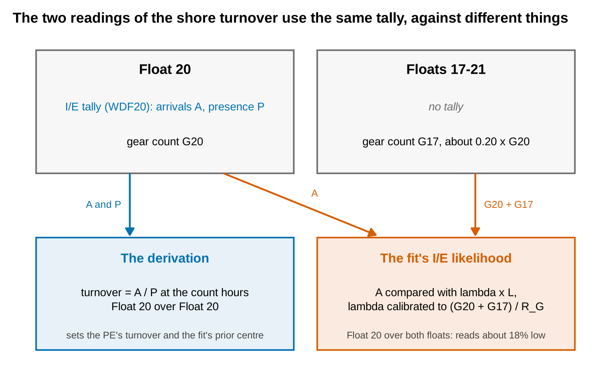
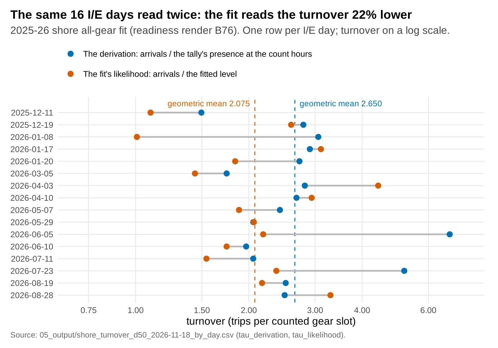
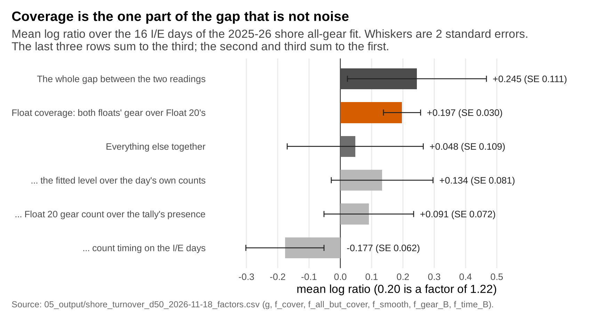
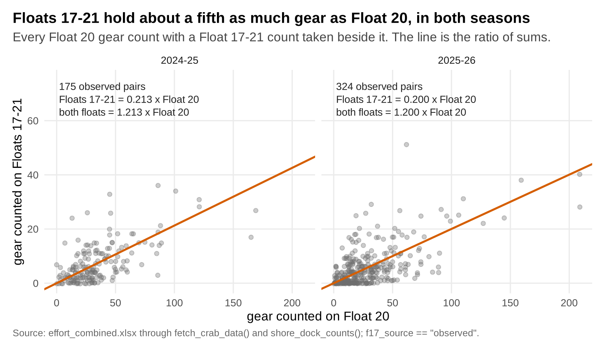
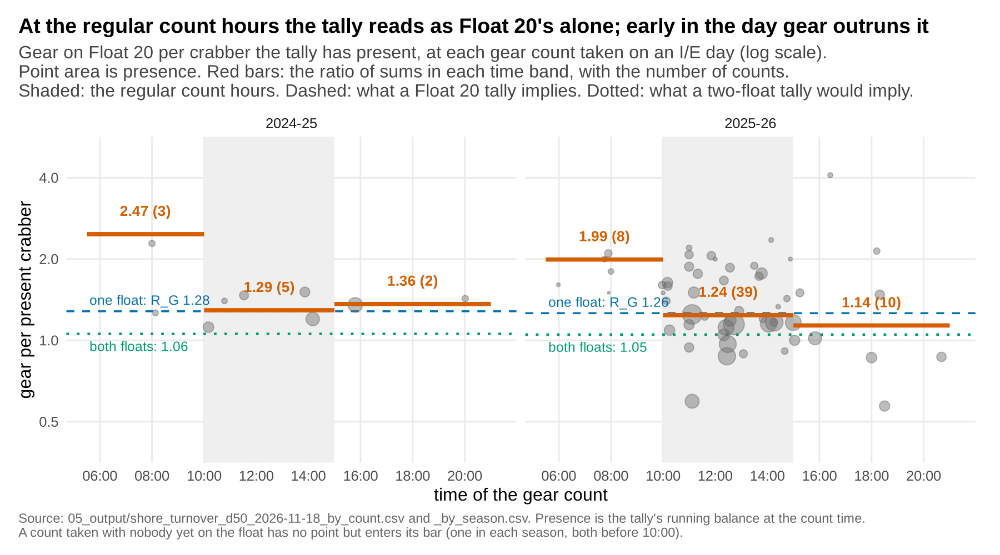
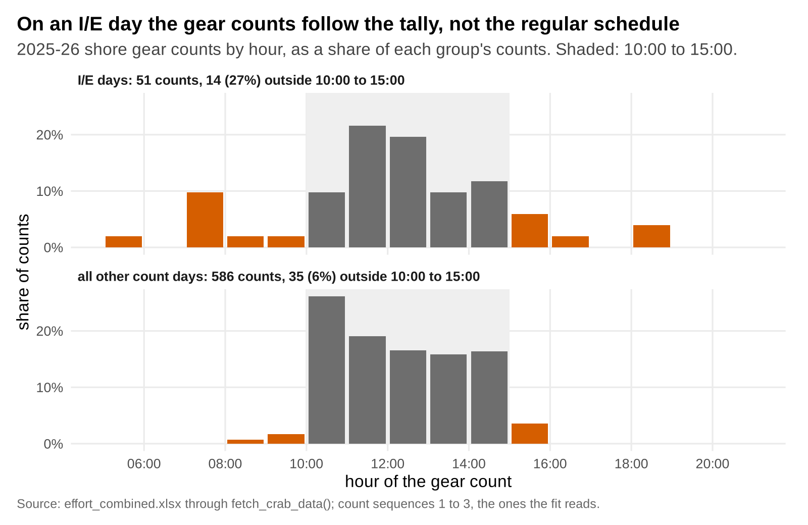
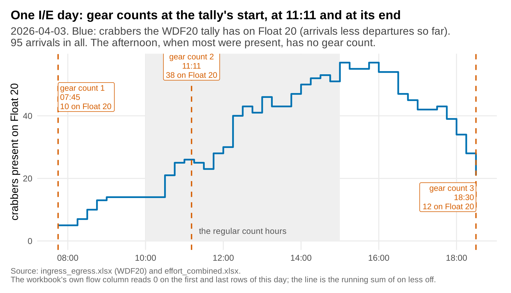
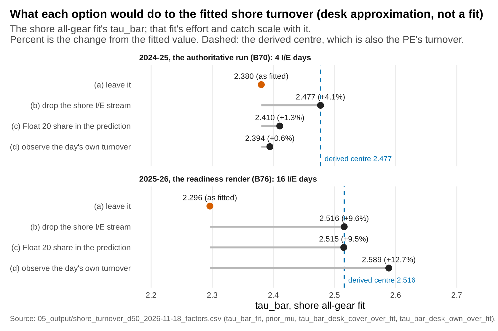

# D51 decision brief: the shore I/E likelihood compares one float with two

**Date:** 2026-11-19. **For:** Matt George. **Status:** an open decision; nothing in the method has changed.
**Authoritative run:** B70, unchanged, port 86,497 [72,869, 104,595].
**Record:** CHANGE_REGISTER rows B78, D50, D51 and D52; VALIDATION_CAMPAIGN Section 1z.20.
**Evidence:** the four tables `05_output/shore_turnover_d50_2026-11-18_{by_day,factors,by_count,by_season}.csv`, written by `06_diagnostics/desk_shore_turnover_d50_2026-11-18.R`. The figures are drawn from those tables and the committed inputs by `06_diagnostics/desk_d51_brief_figures_2026-11-19.R`. No model was fitted for this brief, and every effect size quoted for an option is a desk approximation until a render replaces it.

## 1. The decision in one paragraph

The shore model reads the ingress/egress (I/E) tally twice. It reads it once outside the fit, as the derived turnover centre that the PE applies and that each shore fit takes as its prior. It reads it again inside the fit, as a likelihood on the day's arrivals. The second reading compares arrivals on Float 20 with a presence level that is calibrated to the gear on Float 20 plus Floats 17-21, so it reads the turnover about 18% low. A shore fit is pulled below its centre in proportion to the I/E days in its window. The decision is what to do with the second reading. Four options are set out in Section 6. I recommend option (b), and Section 7 says what would change that.

| Shore all-gear fit | I/E days in the fit | Derived centre | Fitted `tau_bar` | The fit sits below its centre by |
|---|---|---|---|---|
| 2024-25, B70, the authoritative run | 4 | 2.477 | 2.380 [1.97, 2.89] | 3.9% |
| 2025-26, B76, the readiness render (not citable, D18) | 16 | 2.516 | 2.296 [1.98, 2.69] | 8.7% |

Putting the fit at its centre would raise that fit's effort and catch by 4.1% on 2024-25 and by 9.6% on 2025-26, because both scale with the turnover.

## 2. Background: what the turnover is, and where the tally enters

### 2.1 Effort is a count times a turnover

The shore effort of a day is built as

```
E[d] = lambda[d] * R_G * L[d]          (02_stan_models/crab_bss_pooled.stan:1221)
```

- `lambda[d]` is the latent number of crabbers present at a count instant. It is what the gear counts observe.
- `R_G` is gear per crabber, from the interviews (1.28 on 2024-25, 1.26 on 2025-26).
- `L[d]` is the **turnover**: gear-deployments over the whole day per gear slot seen at a count instant. In the shipped model `L[d] = tau_bar * exp(0.15 * L_raw[d])`, one level `tau_bar` with a small fixed day-to-day spread.

This is the instantaneous-count expansion of creel survey practice, in which effort is a count multiplied by the extent of the fishing day (Hoenig et al. 1993; Pollock et al. 1994). The pipeline's unit is gear-deployments and not hours, because catch is sub-linear in soak time for this gear, so the multiplier is a turnover and not a day length (Method v2.0, Section 14.4).

### 2.2 The tally

On an I/E day a sampler at Float 20 records, in 15-minute intervals through the day, the crabbers walking on and off. The workbook `04_input_files/ingress_egress.xlsx` holds 40 such days at location `WDF20`: 2 in 2022-23, 15 in 2023-24, 6 in 2024-25 and 17 in 2025-26. Two quantities come out of a day: the **arrivals** `A` (everyone who walked on) and the **presence** `P(t)` (arrivals less departures so far). The workbook holds no tally for Floats 17-21.

### 2.3 Reading one: the derivation, outside the fit

`estimate_shore_turnover()` (`03_R_functions/bss_day_length.R:528`) takes each I/E day's presence by hour, weights it by the hours at which the season's gear counts were actually taken, and forms

```
turnover = sum over days of A  /  sum over days of (presence at the count hours)
```

It pools all 40 days and gives 2.477 with the 2024-25 count hours and 2.516 with the 2025-26 ones. Its bootstrap log-SE is about 0.06, floored at 0.10. Two things consume it:

- the **PE** multiplies every day's count by it;
- each shore **fit** takes it as the centre of the `tau_bar` prior, lognormal with log-SD 0.10.

It was adopted on 2026-09-08 (CHANGE_REGISTER A19), replacing a literal 1.7 that had been arrivals over peak presence.

### 2.4 Reading two: the likelihood, inside the fit

Inside the fit the same days appear again (`crab_bss_pooled.stan:1034` to `1038`; the gear-resolved program carries the same lines at 864 to 868):

```
ie_pred   = lambda[day] * L[day]
A[day]    ~ lognormal(log(ie_pred), sigma_IE)
```

The stream is used only when a fit has at least three I/E days (`ie_min_obs_shore`, `run_config.R:1450`). That is why the pot-closure fits, with 0 to 2 such days, do not carry it and sit at their prior.

### 2.5 Why there are two readings

The likelihood is the older of the two. Until 2026-09 the prior centre was a literal 1.7 with a log-SD of 0.3, and the I/E stream was the only data in the fit that bore on the turnover. Since A19 the prior itself is built from the tally, so the stream has become a second reading of days the prior has already used.

## 3. The issue



*Figure 1. What each reading compares.*

The arrivals `A` are Float 20's. The level `lambda` is not. It is calibrated by the gear-count likelihood `Gear_I ~ NB2(lambda * R_G * dayfac)` (`crab_bss_pooled.stan:970`), and the gear count it sees is Float 20 plus Floats 17-21 (`shore_dock_counts()`, `03_R_functions/fetch_crab_data.R:360`; a Float 17-21 count that was not taken is filled by the month's ratio since B45). So `lambda * L` predicts the arrivals of **both** floats, and the observation it is compared with is **one** float's. No term relates the two.

The expected size of the error follows from the gear alone. Both floats hold about 1.20 times the gear of Float 20, so the observed arrivals should come in at about 1 / 1.20 = 0.83 of the prediction, and the fit resolves that by lowering the turnover.

This is the second units mismatch found in this stream. Until 2026-08-25 it compared crabber-hours with trips (PIPELINE_STATUS, Tier 1, closed 2026-09-01).

**Why it was not seen earlier.** Three things hid it. Before B45 (2026-09-28) an unsampled Float 17-21 count was read as zero, which made the two-float count smaller and the mismatch with it. On 2024-25 the fit has four I/E days and a noisy stream, so the pull was 4%. And a fitted value between the window's own 2.225 and the pooled 2.477 looked like the data choosing a compromise; the method document said so until 2026-11-18. The 2025-26 readiness render has 16 I/E days, and there the same mechanism is a 9% effect and most of a 14.5% effort gap between the PE and the BSS (D50).

## 4. The evidence

### 4.1 The same days give two readings



*Figure 2. The 16 I/E days of the 2025-26 shore all-gear fit, each read both ways.*

On the same 16 days the derivation reads 2.650 and the likelihood reads 2.075, as geometric means. The log gap is 0.245 with a between-day standard error of 0.111. As ratios of sums the two are 2.605 and 2.302.

### 4.2 The fitted turnover is the prior plus this stream, and nothing else

If the stream is what moves `tau_bar`, then combining the prior and the stream by their precisions on the log scale should reproduce the fitted value. For a normal prior and a normal likelihood the posterior mean is that precision-weighted average (Gelman et al. 2013, Section 2.5). A day's log ratio carries variance `sigma_IE^2 + 0.15^2`.

| Fit | Prior centre (log-SD 0.10) | Stream's centre | `sigma_IE` | I/E days | Predicted `tau_bar` | Fitted `tau_bar` |
|---|---|---|---|---|---|---|
| 2025-26 shore all-gear | 2.516 | 2.075 | 0.405 | 16 | 2.301 | 2.296 |
| 2024-25 shore all-gear (B70) | 2.477 | 1.726 | 0.569 | 4 | 2.386 | 2.380 |

The prediction lands within 0.3% of both fits. Nothing else in the model is pulling the shore turnover. This same calculation is what prices the options in Section 5.

### 4.3 Where the gap comes from

Per I/E day the two readings differ by exactly `lambda / Pbar`, the fitted level over the tally's presence at the season's count hours. That ratio factors exactly into four measurable parts:

| Factor | Definition | What it would mean |
|---|---|---|
| Float coverage | both floats' gear over Float 20's gear | the likelihood compares unlike quantities |
| Level over counts | the fitted level over the day's own counts | the fitted level differs from what was counted that day |
| Gear over presence | Float 20 gear count as crabbers, over the tally's presence at the count | a gear count is not a snapshot of the tally's presence |
| Count timing | the tally's presence at the day's counts, over its presence at the season's count hours | the day's counts were taken at unusual hours |



*Figure 3. The four parts of the gap, as mean logs over the 16 days.*

Coverage is 0.197 with a standard error of 0.030, which is 6.6 standard errors from zero. Everything else together is 0.048 with a standard error of 0.109. The three remaining parts are each of a size with their own uncertainty, and they partly cancel.

### 4.4 Coverage is a constant of the fishery, not a fluctuation



*Figure 4. Every Float 20 gear count that has a Float 17-21 count beside it.*

On 324 observed pairs in 2025-26 both floats hold 1.200 times Float 20's gear. On 175 pairs in 2024-25 the figure is 1.213. The factor does not depend on any fit, and it is the same in both seasons.

### 4.5 Is the tally really Float 20's alone? The one check the data allow

The whole argument rests on the tally covering Float 20 and not Floats 17-21. The location code says so, but a code is not a measurement. The data allow one test. If the tally is Float 20's, then at a gear count the gear on Float 20 divided by the crabbers the tally has present should equal the interview value `R_G`. If the tally also counted Floats 17-21, the same ratio would read `R_G / 1.20`.



*Figure 5. Float 20 gear per crabber the tally has present, at every gear count taken on an I/E day.*

| Season | Counts, 10:00 to 15:00 | Measured (bootstrap SE over days) | 95% interval | If one float | If both floats | Distance from "both floats" |
|---|---|---|---|---|---|---|
| 2025-26 | 39 on 17 days | 1.240 (0.076) | 1.125 to 1.426 | 1.261 | 1.051 | 2.5 SE |
| 2024-25 | 5 on 4 days | 1.293 (0.106) | 1.188 to 1.501 | 1.282 | 1.057 | 2.2 SE |

Both seasons sit on the one-float value and outside the two-float one. This is the same measurement that supports the derivation's own premise, that a Float 20 gear count over `R_G` is the tally's presence. It holds at the regular count hours, at 0.983 and 1.009 of `R_G`.

**This is the weakest link, and you can settle it better than the data can.** The evidence is about 2.2 to 2.5 standard errors in each season. If the WDF20 sampler in fact tallies people bound for Floats 17-21 as well, the coverage argument falls and the gap needs another explanation. See question 1 in Section 9.

Two side observations from the same figure are recorded as D52. Before 10:00 there are about two gear in the water per crabber present (1.99 on 8 counts, 2.47 on 3), which reads as gear left unattended or early crabbers bringing more. Those hours carry 3.5% of the count-hour weight, so the derivation is barely touched.

### 4.6 On an I/E day the gear counts follow the tally, not the regular schedule



*Figure 6. When the gear counts are taken, on I/E days and on all other count days, 2025-26.*



*Figure 7. One I/E day in detail.*

On an I/E day the first count is typically taken as the tally starts and the last as it ends. In 2025-26, 27% of I/E-day counts fall outside 10:00 to 15:00, against 6% on other days; in 2024-25 the figures are 38% and 8%. The count likelihood has no hour term, so it reads those counts as regular ones, and the fitted level on I/E days comes out low. Summed over the 16 days, the Float 20 share of the fitted level is 0.91 of what the tally says was present at the regular count hours.

This matters for the options. It means that correcting for coverage alone does not make the fit's reading like for like: a second distortion, of the opposite sign, stays inside the comparison (Section 6, option (c)). Instantaneous counts have to be scheduled to represent the fishing day for the expansion to be unbiased (Hoenig et al. 1993), and the I/E days are the days on which they are not.

### 4.7 What the "level over counts" part is

The count likelihood carries a per-day effort effect with mean one (A39). A mean-one lognormal has a median below one, so on any count day the fitted level sits above the day's own counts on the log scale, by `sigma_uE^2 / 2`, about 0.105 here (Limpert et al. 2001 for the lognormal's mean and median). The I/E days read -0.112 and all 170 count days read -0.095. The I/E days are therefore not unusual. This part of the gap is a constant of the parametrisation, and the I/E prediction does not carry the day effect that would cancel it.

### 4.8 What the tally cannot tell us

- **Floats 17-21 may not turn over like Float 20.** No tally exists there. Every option below assumes the two are alike.
- **A tally that ends at 18:00 misses a summer evening.** On the two days the tally ran past 20:00, 12 of 152 arrivals (8%) came at 18:00 or later. Both readings share this, so the derived centre may be a few percent low in the long-day months.
- **A crabber who steps off and returns may be tallied twice.** The workbook cannot show it. It would raise the arrivals in both readings.

## 5. How much it matters



*Figure 8. The fitted shore turnover under each option, by desk approximation.*

| | (a) leave it | (b) drop the stream | (c) Float 20 share | (d) day's own turnover |
|---|---|---|---|---|
| **2024-25, B70** | | | | |
| `tau_bar`, shore all-gear | 2.380 | 2.477 | 2.410 | 2.394 |
| Shore all-gear catch | 31,130 | about 32,400 (+4.1%) | about 31,500 (+1.3%) | about 31,300 (+0.6%) |
| Port total | 86,497 | about 87,800 (+1.5%) | about 86,900 (+0.5%) | about 86,700 (+0.2%) |
| BSS against PE, shore all-gear effort | -6.3% | -2.5% | -5.1% | -5.7% |
| **2025-26, B76 (not citable)** | | | | |
| `tau_bar`, shore all-gear | 2.296 | 2.516 | 2.515 | 2.589 |
| Shore all-gear effort and catch | as rendered | +9.6% | +9.5% | +12.7% |
| BSS against PE, shore all-gear effort | -14.5% | -6.4% | -6.4% | -3.6% |

Three things put these numbers in proportion.

1. **On the authoritative run the effect is small against the interval.** The largest option moves the port total by 1.5%, and the 95% half-width of that total is 18%.
2. **The effect grows with good sampling.** It is 4% on four I/E days and 10% on sixteen. The protocol aims for more I/E days, so leaving the stream as it is means the bias rises as the data improve.
3. **It does not explain all of D50.** With the turnover put right, the 2025-26 shore all-gear catch would still sit about 15% under the PE. About 9 points of that are a CPUE difference, and about 6 points are an effort difference that 2024-25 shows too. Both stay open.

## 6. The options

### Option (a): leave the model as it is, and state the bias

**What it is.** No change. The limitation is already written into the method document (limitation 17) and the season guide.

**Positives**
- No render, no new code, no risk of a new defect.
- The authoritative run stays exactly as accepted.
- The exposure on 2024-25 is small against the interval.
- The decision can wait for the complete 2025-26 data and OSP's record, and be taken with other changes in one render.

**Negatives**
- A known, signed, definitional bias stays in the method of record.
- It grows with the number of I/E days, which is the opposite of what more sampling should do.
- The PE-against-BSS comparison, which the guide uses as a trust check, stays contaminated: the PE uses the centre and the BSS a lower value, so a shore gap of 8 points appears on 2025-26 that is not a disagreement about the fishery.
- A fitted `tau_bar` below its centre invites the wrong reading, that the window's days prefer a lower turnover.
- Every report has to carry the caveat.

**Needs.** Nothing.

### Option (b): drop the shore I/E stream from the fits

**What it is.** Raise `ie_min_obs_shore` above the number of I/E days in the window, on both tracks. The stream is then dropped, exactly as it already is for the pot-closure fits. The tally informs the turnover once, through the derivation, and `tau_bar` sits at its prior: 2.477 [2.04, 3.01] on 2024-25, 2.516 [2.07, 3.06] on 2025-26.

**Positives**
- Configuration only. No Stan change and no recompile. Fully reversible by restoring the key.
- It removes the mismatched comparison altogether, not just its largest part.
- It also ends the double use of the in-window tally days, once in the centre and once in the likelihood.
- It is immune to the I/E-day count schedule and to the day-effect constant of Section 4.7, because the fitted level no longer enters the turnover.
- It is a code path every render already exercises, in the pot-closure fits, with `sigma_IE` reported as its prior.
- The PE and the BSS then share one turnover, so their comparison isolates what the two estimators really disagree on.

**Negatives**
- The fit no longer learns anything about the turnover from its own window. The centre then rests entirely on the D24 choice between the pooled 40 days and the window's own days. On 2024-25 the window's six days read 2.225 against the pooled 2.477, and this option moves the fit toward the pooled value. If the window's lower reading is real, the move is in the wrong direction. D24 was closed by decision, with the model unable to choose between the two centres.
- It gives up the arrivals' information about the level on the I/E days, and the `sigma_IE` readout that the derivation's own console note points to as the in-window check.
- The authoritative run moves, by about +1.5% on the port, and has to be rendered and accepted again.
- The turnover's uncertainty becomes exactly the prior's. Its log-SD of 0.10 is a floor set by hand above a bootstrap value of 0.06, so that one number then carries the whole of the shore turnover's contribution to the interval.
- Using a guard key as an off-switch is inelegant. A dedicated key would be a small change in both preps.

**Needs.** A render of both tracks under a rule written first (Section 8). The boat fits, the pot-closure fits and the census should reproduce B70 draw for draw.

### Option (c): put the Float 20 share into the I/E prediction

**What it is.** Multiply the prediction by Float 20's share of the gear, `ie_pred = lambda * L * share`, with the share supplied as data per observation: the day's Float 20 gear over both floats', or the season's 1 / 1.20. It touches both Stan programs and both preps.

**Positives**
- It corrects the mismatch where it arises and keeps the stream, so the fit still learns from its own window and keeps the `sigma_IE` check.
- It is the smallest move of the authoritative run, about +0.5% on the port.
- With a share of one the model is unchanged, so a fishery with a single counted location is handled without a switch.
- A fit with no I/E stream should reproduce its present draws exactly, which gives the render a sharp test.

**Negatives**
- It needs a Stan data change, a recompile of both programs, and validation on two tracks.
- It leaves two distortions inside the comparison: the I/E-day count schedule and the day-effect constant. On 2025-26 they happen to nearly cancel on the log scale (-0.043, SE 0.094). Nothing makes them cancel on another season. The corrected reading would sit 10% above the derivation as a ratio of sums and 5% below it as a geometric mean, which is a sign that the comparison is still not clean.
- The share is itself partly modelled. A Float 17-21 count is taken beside only about half of the Float 20 counts and is otherwise filled by the month's ratio; on the 2025-26 I/E days, 31 of 57 counts have an observed pair.
- The in-window tally days are still used twice, so the fitted turnover is stated more precisely than the information supports: on 2025-26, a log-SD of about 0.073 where the prior alone gives 0.10.

**Needs.** The code change, then a render of both tracks under a rule written first.

### Option (d): observe the day's own turnover

**What it is.** Replace the arrivals likelihood with a direct observation of the day's turnover: the day's arrivals over the tally's presence at the season's count hours, observed on `L[d]`. The fitted level `lambda` leaves the turnover's likelihood.

**Positives**
- It is like for like in every respect: one float, one unit, the regular count hours.
- It is immune to coverage, to the count schedule and to the day-effect constant.
- The fit keeps an in-window observation of the turnover, day by day, so it can respond to a season whose turnover really differs.

**Negatives**
- It is the largest change: a new observation built in both preps, a new likelihood in both programs, a recompile, and diagnostics whose meaning changes.
- The double use of the tally is at its most direct. The same daily ratios would build the centre and the likelihood. Avoiding that means rebuilding the centre without the window's days, which for 2025-26 would rest it on 23 days, 17 of them from the two seasons that are out of scope for the model.
- It re-opens D24 by another route. The window's own days gain weight: +12.7% on 2025-26, toward that window's 2.650, and only +0.6% on B70, whose four days read 2.186. Whether that is a merit depends on whether you believe turnover differs by window, and D24 decided for the pooled centre.
- The daily ratio is noisy, with a between-day log-SD of 0.33 to 0.34, so four to six days add little. The benefit is confined to seasons with many I/E days.

**Needs.** The code change, a decision on the centre's construction, then a render of both tracks under a rule written first.

## 7. Comparison and recommendation

| | (a) | (b) | (c) | (d) |
|---|---|---|---|---|
| Removes the float mismatch | no | yes | yes | yes |
| Immune to the I/E-day count schedule | no | yes | no | yes |
| Uses the in-window tally days once only | no | yes | no | no |
| Fit still learns turnover from its window | yes, with bias | no | yes | yes |
| Code change | none | one key | Stan and preps | Stan and preps, larger |
| Stan recompile | no | no | yes | yes |
| Authoritative run moves | no | about +1.5% | about +0.5% | about +0.2% |
| Reversible without code | yes | yes | no | no |

**I recommend (b).** The stream and the derivation are the same tally days. The derivation reads them within one float and at the regular count hours. The stream reads them against a level that covers two floats and that is itself distorted on exactly those days. So the stream is not a second measurement; it is a second, worse reading of data already used. Option (b) removes it at the cost of one configuration key and can be undone.

**If you want the fit to keep an in-window turnover observation, choose (d) and not (c).** Option (c) repairs the largest fault and leaves the comparison dependent on a cancellation. Option (d) is the clean form of what (c) is trying to be.

**Where this argument could be wrong.**
- If the WDF20 tally in fact covers Floats 17-21, coverage is not the cause, and the measured 2.2 to 2.5 standard errors in Section 4.5 are the only evidence against that.
- If turnover really differs by season, dropping the stream discards real information. The two fitted seasons' own readings are 2.225 and 2.595, a log difference of 0.154 with a standard error of about 0.16, so the data do not show a difference, but they cannot exclude one.
- The numbers in Section 5 assume the fitted level would not shift when the stream changes. The approximation reproduces the present fits, but a render is the test, and this project's rule is that a change is confirmed by a run.
- The pre-registered rule did not certify this reading (Section 8). The conclusion rests on evidence added after the first table.

## 8. What the pre-registered rule said, and a proposed rule for the render

**The rule that was written first** (commit `8af6e2f`) judged each factor on its mean log: material at 0.03, and accounting for the gap at half of it. Applied as written, all four factors were material, coverage and the level-over-counts factor each passed the threshold, and the proviso that would have certified the derivation read 1.115 against a limit of 1.10. **The rule certified neither reading.** Pre-registration separates a confirmatory test from an exploratory one (Nosek et al. 2018), and by that standard the reading in this brief is exploratory. Three flaws in the rule were mine: it judged factors one at a time when the count schedule ties three of them together; it misread the level-over-counts factor, which is the constant of Section 4.7; and it used mean logs, the scale of the fit's likelihood, where the derivation's premise is a ratio of sums.

**A proposed rule for a render of option (b)**, for you to amend before anything runs:

1. Every fit on both tracks passes the convergence gate.
2. The boat fits, the pot-closure fits and the census reproduce B70 draw for draw, since their Stan data do not change.
3. The two shore all-gear fits carry no I/E observation, and their `tau_bar` is its prior: the median within 1% of 2.477 and the 95% limits within 3% of 2.04 and 3.01.
4. The shore all-gear effort rises by 2% to 6% on each track, and the fit's catch per unit effort moves by less than 1%.
5. The cross-check stays within 2%.
6. Reported and not judged: the fitted level on the four I/E days, and the port interval's width.

## 9. Questions only you or the samplers can answer

1. **Where does the WDF20 sampler stand, and can a crabber reach Floats 17-21 without being tallied?** This decides whether Section 4.5 is right.
2. **Are the first and last gear counts on an I/E day meant as effort counts?** If they are taken only because the sampler is there, they should perhaps not enter the count likelihood as regular counts (D52).
3. **Is a crabber who leaves the float and comes back tallied as a new arrival?**
4. **Is gear left in the water unattended, overnight or early in the morning?** That would explain the two gear per crabber before 10:00.
5. **Can a tally be run on Floats 17-21 for a few days next season?** It is the only way to test the assumption every option shares.

## 10. References

Gelman, A., Carlin, J. B., Stern, H. S., Dunson, D. B., Vehtari, A., and Rubin, D. B. (2013). *Bayesian Data Analysis*, 3rd ed. CRC Press. Section 2.5, the normal model with known variance: the posterior mean as a precision-weighted average of the prior mean and the data.

Hoenig, J. M., Robson, D. S., Jones, C. M., and Pollock, K. H. (1993). Scheduling counts in the instantaneous and progressive count methods for estimating sportfishing effort. *North American Journal of Fisheries Management* 13(4), 723-736.

Limpert, E., Stahel, W. A., and Abbt, M. (2001). Log-normal distributions across the sciences: keys and clues. *BioScience* 51(5), 341-352.

Nosek, B. A., Ebersole, C. R., DeHaven, A. C., and Mellor, D. T. (2018). The preregistration revolution. *Proceedings of the National Academy of Sciences* 115(11), 2600-2606.

Pollock, K. H., Jones, C. M., and Brown, T. L. (1994). *Angler Survey Methods and Their Applications in Fisheries Management.* American Fisheries Society Special Publication 25.

**Repository sources.** `02_stan_models/crab_bss_pooled.stan` lines 970, 1034 to 1038 and 1221; `02_stan_models/crab_bss_gear_resolved.stan` lines 864 to 868; `03_R_functions/bss_day_length.R` line 528; `03_R_functions/fetch_crab_data.R` line 360; `run_config.R` lines 649 to 651 and 1450; the run folders `05_output/20261019/pooled-CPUE-2024-25` (B70) and `05_output/20261020/pooled-CPUE-season-2025-26` (B76); commits `8af6e2f` (the rule), `f2be2ff` (the script and tables) and `2687b09` (the reading).
